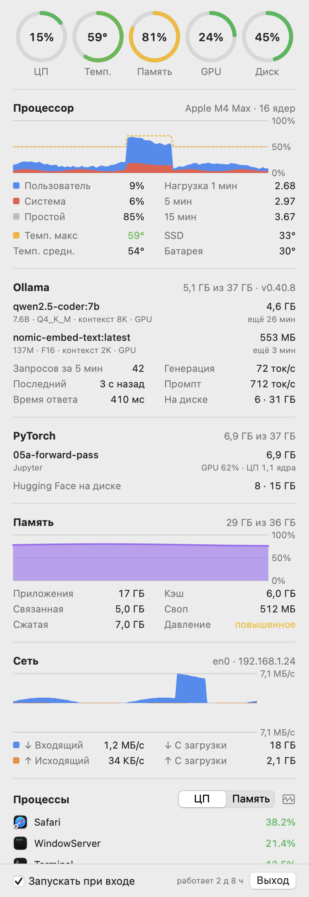

# SysLoad

Лёгкая утилита для строки меню macOS: коротко показывает загрузку процессора и GPU, мощность всего Mac и температуру, а по клику — подробную панель.




## Что умеет

- **Строка меню**: две колонки по две мелкие строки, `CPU 15%` над `GPU 24%` и `PWR 23W` над `TMP 59°`, ≈100 pt ширины. Мощность — сколько потребляет весь Mac, температура — самый горячий датчик кристалла процессора. Цифры обычного цвета, к 80% / 80° / 80 Вт желтеют, у 100% / 100° / 100 Вт — красные; ширина фиксирована, строка не «прыгает». Пока запущена Ollama, слева от цифр — значок: бледный — ни одна модель не загружена; с моделями — от зелёного до красного по тому, какую часть памяти GPU они занимают (на Mac с 48 ГБ это до 37 ГБ: модель 7B — зелёная, 35B — оранжевая); пока модель отвечает, значок залит. Пока работает процесс Python с PyTorch (Jupyter-ядро, скрипт, обучение) — рядом значок-пламя: цвет по той же шкале памяти GPU, залит, пока процесс считает.
- **Панель по клику**:
  - кольца: ЦП, температура, память, GPU, диск;
  - **процессор** — график за 3 минуты (пользователь / система + линия температуры), простой, средняя нагрузка за 1/5/15 минут, температура (макс. и средняя по кристаллу, SSD, батарея), модель чипа и число ядер;
  - **Ollama** — сколько памяти GPU заняли модели, модели в памяти (размер, параметры, квантизация, контекст, GPU или ЦП, через сколько выгрузится), запросы за 5 минут, время ответа, скорость генерации и чтения промпта, сколько моделей скачано;
  - **PyTorch** (пока есть такие процессы) — каждый процесс: проект (папка с `.venv`), Jupyter или скрипт, память, загрузка GPU и ЦП; сколько моделей Hugging Face скачано. Какая модель загружена и скорость в токенах снаружи не видны: transformers работает внутри процесса и ничего не сообщает;
  - **память** — график, приложения / связанная / сжатая / кэш (как в «Мониторинге системы»), своп, давление памяти;
  - **сеть** — график входящего и исходящего трафика, текущая скорость, объём с момента загрузки, основной интерфейс и IP;
  - **процессы** — топ по ЦП или памяти, вспомогательные процессы сгруппированы по приложению (все `Code Helper` → `Visual Studio Code`).
- **Автозапуск** при входе (LaunchAgent), переключатель в панели.

Опрос — раз в 2 секунды. Список процессов, диск и статистика Ollama читаются только пока панель открыта, так что в фоне приложение почти ничего не тратит (≈0,6% ЦП). Значок Ollama в фоне следит за её процессами (раз в 6 секунд — какие есть, каждые 2 секунды — их процессорное время); API спрашивается, только когда процессы меняются, и раз в минуту, чтобы не засорять лог Ollama. Процессы PyTorch ищутся так же раз в 6 секунд, их память и время ЦП и GPU читаются каждые 2 секунды.

## Установка

Нужны macOS 14+ и Swift (Xcode или Command Line Tools).

```bash
./scripts/install.sh     # сборка → ~/Applications/SysLoad.app, автозапуск, старт
./scripts/uninstall.sh   # удалить приложение и автозапуск
```

## Откуда данные

- ЦП — `host_statistics(HOST_CPU_LOAD_INFO)`, разница тиков между замерами.
- Память — `host_statistics64(HOST_VM_INFO64)`, своп — `vm.swapusage`, давление — `kern.memorystatus_vm_pressure_level`.
- Сеть — 64-битные счётчики `NET_RT_IFLIST2` по физическим интерфейсам; туннели VPN (`utun*`), `lo0`, AirDrop не считаются, чтобы трафик не задваивался.
- GPU — загрузка считается как прирост `accumulatedGPUTime` всех Metal-клиентов в IORegistry за 2 секунды (то же, что столбец «Время GPU» в «Мониторинге системы»); мгновенный `Device Utilization %` из `PerformanceStatistics` у `IOAccelerator` на почти простаивающем GPU прыгает до 60–90%, он остаётся запасным вариантом для GPU, у клиентов которых этого времени нет. Память GPU — оттуда же, из `PerformanceStatistics`.
- Температура — датчики Apple Silicon через `IOHIDEventSystemClient` (`PMU tdie*` — кристалл, `NAND` — SSD, `gas gauge battery`). Это приватный API, он подключается через `dlsym`: если Apple его уберёт, температура просто покажется как «—». На Intel-маках этих датчиков нет.
- Мощность — ключ `PSTR` в SMC (`AppleSMC`), общая мощность системы. Прав root не нужно, но это мгновенный замер, поэтому число скачет сильнее, чем загрузка ЦП. Интерфейс приватный: если ключа нет, вместо числа «—».
- Процессы — `ps`.
- Ollama — HTTP API на `127.0.0.1:11434` (`/api/ps`, `/api/tags`, `/api/version`). Запросы и скорость — из лога сервера: `~/.ollama/logs/server.log` у приложения Ollama, `/opt/homebrew/var/log/ollama.log` у `brew services`; читается только дописанное с прошлого раза. Скорость пишет раннер llama.cpp; если её в логе нет — «—». «Отвечает» — когда процессы Ollama (сервер и раннеры моделей, ищутся по пути) тратят больше 0,2 ядра: при генерации это несколько ядер, в простое — ноль, даже если модель работает на GPU. Предел памяти GPU — `recommendedMaxWorkingSetSize` из Metal, его же Ollama считает своей VRAM. Если Ollama не установлена, раздела нет.
- PyTorch — процессы Python, у которых в памяти загружены библиотеки `torch/lib/` (`PROC_PIDREGIONPATHINFO`); дочерние процессы с torch (воркеры DataLoader) считаются вместе с родителем. Память — `ri_phys_footprint` (как «Память» в «Мониторинге системы», выделенное под GPU входит). Время GPU — `accumulatedGPUTime` у Metal-клиентов процесса в IORegistry (столбец «Время GPU» в «Мониторинге системы»). «Считает» — GPU занят им больше 5% времени или ЦП больше 0,5 ядра. Скачанные модели — `~/.cache/huggingface/hub` (`HF_HOME` приложению не виден).

## Разработка

```bash
swift build -c release
.build/release/SysLoad --snapshot docs          # панель и строка меню в PNG на выдуманных данных
.build/release/SysLoad --snapshot /tmp/x --live # то же на реальных данных
```
