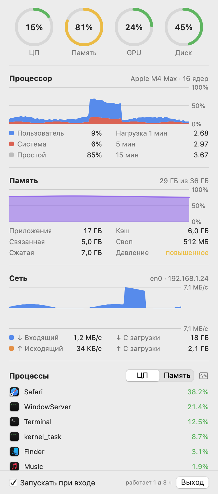

# SysLoad

Лёгкая утилита для строки меню macOS: коротко показывает загрузку процессора и памяти, а по клику — подробную панель.




## Что умеет

- **Строка меню**: `CPU 15%  RAM 80%`. Цифры обычного цвета, при нагрузке от 70% желтеют, у 100% — красные. Ширина фиксирована, строка не «прыгает».
- **Панель по клику**:
  - кольца: ЦП, память, GPU, диск;
  - **процессор** — график за 3 минуты (пользователь / система), простой, средняя нагрузка за 1/5/15 минут, модель чипа и число ядер;
  - **память** — график, приложения / связанная / сжатая / кэш (как в «Мониторинге системы»), своп, давление памяти;
  - **сеть** — график входящего и исходящего трафика, текущая скорость, объём с момента загрузки, основной интерфейс и IP;
  - **процессы** — топ по ЦП или памяти, вспомогательные процессы сгруппированы по приложению (все `Code Helper` → `Visual Studio Code`).
- **Автозапуск** при входе (LaunchAgent), переключатель в панели.

Опрос — раз в 2 секунды. Список процессов, GPU и диск читаются только пока панель открыта, так что в фоне приложение почти ничего не тратит (≈0,5% ЦП).

## Установка

Нужны macOS 14+ и Swift (Xcode или Command Line Tools).

```bash
./scripts/install.sh     # сборка → ~/Applications/SysLoad.app, автозапуск, старт
./scripts/uninstall.sh   # удалить приложение и автозапуск
```

## Откуда данные

- ЦП — `host_statistics(HOST_CPU_LOAD_INFO)`, разница тиков между замерами.
- Память — `host_statistics64(HOST_VM_INFO64)`, своп — `vm.swapusage`, давление — `kern.memorystatus_vm_pressure_level`.
- Сеть — 64-битные счётчики `NET_RT_IFLIST2` по физическим интерфейсам; туннели VPN (`utun*`), `lo0`, AirDrop не считаются, чтобы трафик не задваивался.
- GPU — `PerformanceStatistics` у `IOAccelerator`.
- Процессы — `ps`.

## Разработка

```bash
swift build -c release
.build/release/SysLoad --snapshot docs          # панель и строка меню в PNG на выдуманных данных
.build/release/SysLoad --snapshot /tmp/x --live # то же на реальных данных
```
